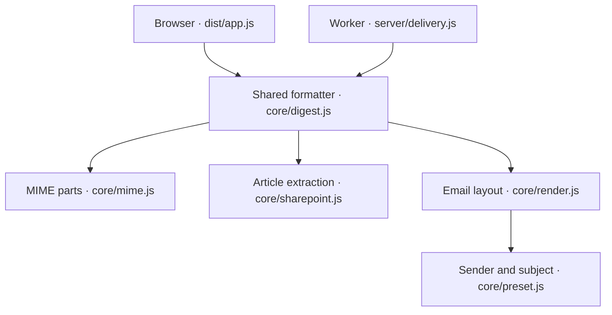
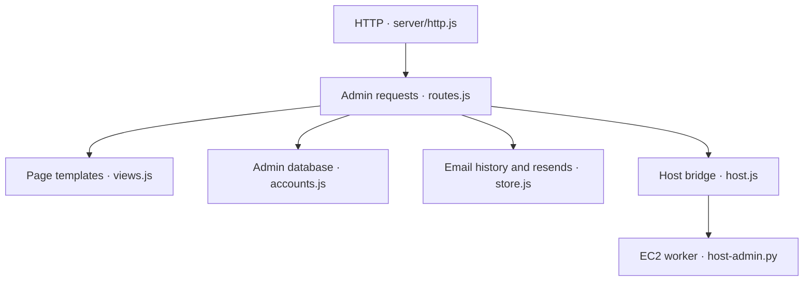

# Digest Bot code map

Start with [How Digest Bot works](how-it-works.md) for the two user workflows. Use this map when you want to change the code or follow a message through the bot.

## Where to make a change

| I want to change… | Start here |
| --- | --- |
| Public tab order, page text or layout | [index.html](../dist/index.html) and [styles.css](../dist/styles.css) |
| Which tab opens first, how a file is selected, or how the group address is copied | [app.js](../dist/app.js) |
| Staff News subject, date format or Manual From address | [preset.js](../dist/core/preset.js) |
| The formatted email's layout, heading or footer | [render.js](../dist/core/render.js) |
| Which links, article details or thumbnails the formatter picks out of SharePoint mail | [sharepoint.js](../dist/core/sharepoint.js) |
| The Careers at Bond link, image or default weekday | [careers.js](../server/careers.js). To change the weekday for this deployment, use **Admin → System → Digest Bot**. |
| Which SMTP messages the bot accepts and who gets the reply | [smtp.js](../server/smtp.js) and [incoming.js](../server/incoming.js) |
| What happens after the bot accepts a digest or SES replies | [store.js](../server/store.js) and [delivery.js](../server/delivery.js) |
| An admin page, control or permission | [views.js](../server/admin/views.js), [routes.js](../server/admin/routes.js) and [permissions.js](../server/admin/permissions.js) |

## Public page and shared formatter

The browser runs **Manual** from [app.js](../dist/app.js). It reads the selected file, shows a sandboxed preview and creates the download. **Automatic** fetches the group address through [http.js](../server/http.js) in both processing modes. In **Server** mode, the email arrives separately at the SMTP listener.

The shared files are under [dist/core](../dist/core). `readDigest()` parses the MIME parts and chooses the SharePoint article fields. `formatDigest()` renders the new HTML and plain-text bodies, then packages them with the headers and inline images as an `.eml` file.

| Supporting file | What it owns |
| --- | --- |
| [mailbox.js](../dist/core/mailbox.js) | Validates a single mailbox and extracts it from a header that can include a display name. |
| [assets/bond-logo.png](../dist/assets/bond-logo.png) | Staff News email logo, loaded by both the browser and the worker. |
| [mark.png](../dist/mark.png) | Public site's icon and header mark. |

## Automatic mail on EC2

Follow the message from SMTP receipt to SES. There is one Node process in the Digest Bot container. It starts HTTP and, when configured, starts the mail listener and delivery worker.

| Step | File and role |
| --- | --- |
| 1. Start | [main.js](../server/main.js) starts and stops the services. [config.js](../server/config.js) validates their environment settings. |
| 2. Connect the mail services | [email-automation.js](../server/email-automation.js) loads the TLS certificate, opens the queue, starts SMTP and starts the worker. |
| 3. Receive and verify | [smtp.js](../server/smtp.js) accepts the message for the bot address. [incoming.js](../server/incoming.js) checks the sender and supplies the recipient and deduplication key. |
| 4. Queue and track | [store.js](../server/store.js) manages pending jobs. [history.js](../server/history.js) keeps the longer-lived timeline and formatted email archives. [sqlite.js](../server/sqlite.js) runs grouped database writes in a transaction. |
| 5. Format and send | [delivery.js](../server/delivery.js) picks the next ready job, checks the SharePoint link destinations, formats the message and hands it to SES. [careers.js](../server/careers.js) and its [article image](../server/assets/careers-at-bond.png) supply the recurring article for the selected Brisbane weekday. |

See the [data model](data-model.md) for what a job, history record and timeline event each represent.

## Admin panel and host controls

The private panel is under `bond-sdc.com/admin`. Caddy forwards these requests to Digest Bot. Pages are rendered by Node, and the route handler checks the session and permissions for each action.

| File | What it owns |
| --- | --- |
| [routes.js](../server/admin/routes.js) | Sign-in, permission checks, form handling, queue actions and requests to the host. |
| [views.js](../server/admin/views.js) and [admin.css](../server/admin/admin.css) | Templates and styles for Email History, System, Users, Roles and Account. |
| [accounts.js](../server/admin/accounts.js) | Password hashing and the SQLite records for accounts, roles, sessions, settings and activity. |
| [permissions.js](../server/admin/permissions.js) | Permission names, built-in roles, page visibility and rules for delegating access. |
| [bootstrap.js](../server/admin/bootstrap.js) | EC2 terminal command that provisions the owner account or resets its password. |
| [notice.js](../server/admin/notice.js) | Clears a confirmation notice from the URL after a form submission. |
| [host.js](../server/admin/host.js) | Writes one maintenance request, reads host status and handles EC2 reboot through the AWS API. |
| [host-admin.py](../deploy/admin/host-admin.py) | EC2 host process that validates requests, saves the approved `.env` settings and selects the Compose files for the saved processing method. |
| [install-updater.sh](../deploy/admin/install-updater.sh), [path unit](../deploy/admin/bond-sdc-admin.path) and [service unit](../deploy/admin/bond-sdc-admin.service) | Install and run the optional systemd watcher for maintenance requests. |

## Deployment and tests

| File | What it owns |
| --- | --- |
| [Dockerfile](../Dockerfile) | Builds the Node image, copies the browser and server files and starts `main.js` as the Node user. |
| [compose.yaml](../compose.yaml) and [Caddyfile](../deploy/Caddyfile) | Start the Caddy and Digest Bot containers and route the public sites and admin panel. |
| [compose.delivery.yaml](../compose.delivery.yaml) and [mail-delivery.caddy](../deploy/mail-delivery.caddy) | Add the public SMTP port, persisted email database and certificate for automatic delivery. |
| [compose.updater.yaml](../compose.updater.yaml) | Mounts the host's request and status directories so the panel can request maintenance. |
| [test/automation.test.js](../test/automation.test.js) | Exercises Manual export, the group address route, SMTP sender checks and queue recovery. |
| [test/mime.test.js](../test/mime.test.js) | Exercises MIME body decoding, inline images and malformed input. |
| [test/admin.test.js](../test/admin.test.js) | Exercises accounts, permissions, email history, resends, Careers scheduling and maintenance status. |

The files under [automation-ui](../automation-ui) preserve the old generated-address interface for reference. The current build serves the public page from [dist](../dist).

From the repo root, run `npm ci` and `npm test` with Node.js 24 or later. The tests simulate the SES and host actions locally. For EC2 configuration, see the [deployment instructions](../deploy/EC2.md) and [admin guide](../deploy/admin.md).
