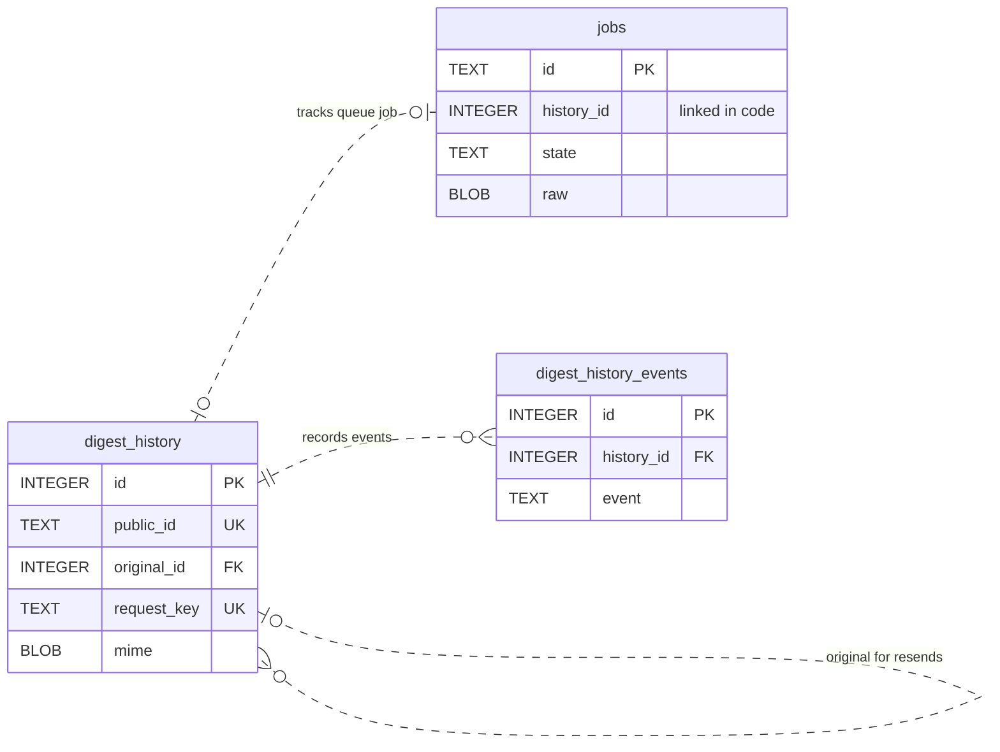
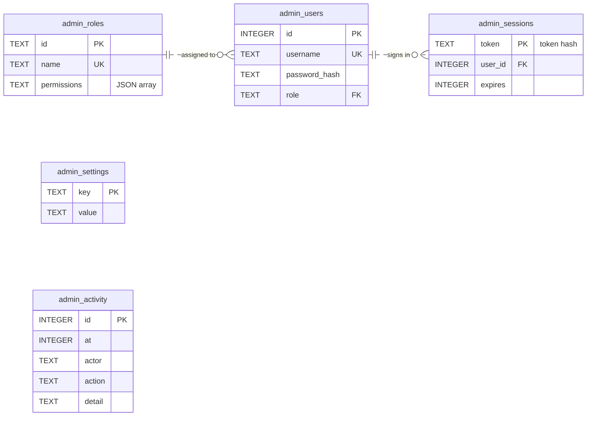

# Digest Bot data model

Digest Bot uses two SQLite files. The mail database tracks automatic delivery and holds the formatted email archive. The admin database holds access and settings. **Manual** formats files in the browser and creates no database rows.

| Database | Container path with Compose | Where it is kept |
| --- | --- | --- |
| Automatic mail and Email History | `/data/digest.sqlite` | `var/data/digest.sqlite` in the EC2 checkout |
| Admin access, settings and activity | `/admin-data/admin.sqlite` | Docker volume `sdc-admin-data` |

## Automatic mail and Email History

| Table | One row represents |
| --- | --- |
| `jobs` | One delivery task. The row holds the raw incoming email or points to the history for a resend. The job state, next available time and attempts let the worker recover across restarts. |
| `digest_history` | An automatic digest, admin resend or rejected or deferred SMTP attempt. The row keeps the latest state and the public `D-…` identifier shown on the admin page. A formatted original also holds a gzip-compressed outgoing `.eml` in `mime`. |
| `digest_history_events` | One timeline entry for a history record. Examples include **Received**, **Preparing** and **Accepted by SES**. |

- `jobs.history_id` is a nullable integer. The store links each new job and history row in the same SQLite transaction.
- `digest_history.original_id` is a foreign key back to the original email record. An original can have several resends. Each resend has a separate timeline and reuses the original archive.
- A queue row can be deleted during cleanup while its history and timeline stay visible. For example, a completed job can disappear after about seven days, and its archived formatted email can still be available under **Email History**. SMTP failures during message processing can have history without a queue row.

For the full mail column definitions, see the queue schema in [store.js](../server/store.js) and the history schema in [history.js](../server/history.js).

## Admin access and settings

Each admin user has one role. A user may have multiple browser sessions. SQLite deletes a user's sessions when that account is removed. A role edit takes effect in existing sessions because each authenticated request reads the current role.

| Standalone table | What it keeps |
| --- | --- |
| `admin_settings` | Values for `outgoing_paused`, `careers_day` and the in-progress `site_update` request. |
| `admin_activity` | The audit trail. The actor is a label, so earlier activity still makes sense if an account changes. **System → Admin Activity** shows the 20 most recent entries. |

The admin tables and settings are defined in [accounts.js](../server/admin/accounts.js). Permission keys and the built-in roles are in [permissions.js](../server/admin/permissions.js).

## Reading the diagrams

| Notation | Meaning |
| --- | --- |
| `PK`, `FK`, `UK` | Primary key, foreign key and unique key respectively. |
| `\|\|` | Exactly one row on that side. |
| `o\|` or `\|o` | Zero or one row on that side. |
| `o{` | Zero or many rows on that side. |

SQLite stores the timestamps shown here as milliseconds since the Unix epoch. Admin pages display them in Brisbane time. String labels such as `actor` are retained for display.
