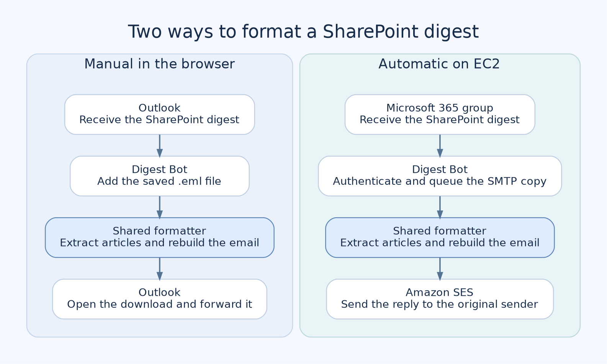
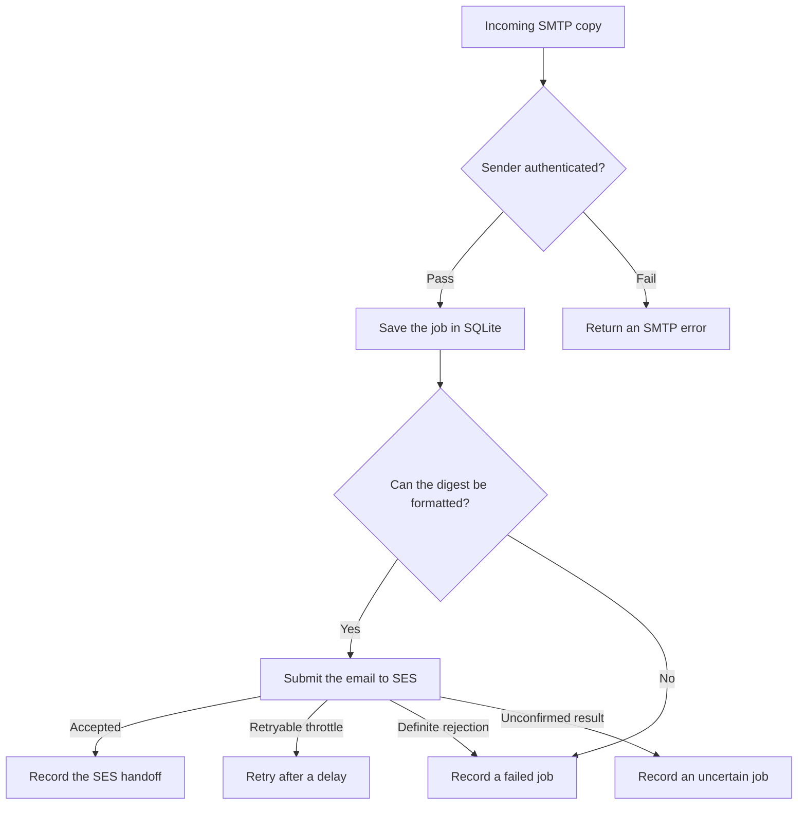

# How Digest Bot works

Digest Bot takes a SharePoint news digest and rebuilds it in the Staff News layout. It uses the same JavaScript formatter whether you download an Outlook file or receive an automatic reply. **Automatic** opens first. Select **Manual** when you have a saved `.eml` file.



## Where the work happens

| Component | Job |
| --- | --- |
| Browser | Opens the website, shows the group address on Automatic and formats files locally on Manual. |
| Caddy on EC2 | Serves Service Desk Central, forwards web requests for Digest Bot and renews certificates. |
| Node.js on EC2 | Serves the Digest Bot pages, receives SMTP mail, authenticates senders and runs the delivery worker. |
| SQLite on EC2 | Keeps the automatic queue, message history and archives across container restarts. A separate file holds admin accounts and settings. |
| Microsoft 365 and Amazon SES | Microsoft 365 delivers the incoming group copy. Amazon SES sends the formatted reply. |

## What happens to the email

Both workflows read the message's *MIME parts*, which hold the subject, text, HTML and inline images. The formatter extracts the news links and article details, then builds a fresh message with the Staff News logo, layout and Brisbane-date subject.

- In **Manual**, the source file stays in the browser. You preview and download the rebuilt `.eml`, then use **Forward** to address and send it in Outlook. The download has the Staff News From header and a blank To field.
- In **Automatic**, SharePoint sends to the Microsoft 365 group and the group delivers an SMTP copy to the bot. The bot uses the email's authenticated From address as the destination and sends the rebuilt message from `digest@bond-sdc.com` through SES.

[Shared formatter](../dist/core) · [Browser workflow](../dist/app.js) · [Automatic delivery worker](../server/delivery.js)

## How automatic delivery decides what to do



1. **Authenticate the sender.** The bot checks a DKIM signature for the From domain first. It can also accept an SPF pass when the SMTP envelope sender uses the same domain as the From header. Successful authentication supplies the address that receives the reply.
2. **Queue the message.** SQLite uses a key derived from the recipient and the message identifier to recognise repeat deliveries. The worker takes one job at a time. It clears the source email when the job reaches a final delivery state. Finished jobs age out after about seven days. Email History keeps its own outcome, timeline and formatted archive after queue cleanup.
3. **Hand off to SES.** The worker submits the complete MIME message to SES in Sydney over HTTPS using the EC2 role. An explicit throttling response can cause up to two retries. If a timeout or interruption leaves the send result uncertain, the worker records that state to avoid a possible duplicate reply.

[Sender authentication](../server/incoming.js) · [Queue storage](../server/store.js) · [EC2 setup and delivery configuration](../deploy/EC2.md)

The **Careers at Bond** article goes at the end of automatic digests formatted on the selected Brisbane weekday. It defaults to Wednesday. An admin can change the day under **System → Digest Bot**. [Admin guide](../deploy/admin.md#manage-the-sites)

## Where delivery time goes

The time you see in Outlook includes Microsoft 365 routing, the bot's processing, and delivery from SES to the recipient's mail server. The logs measure the portion the bot can see.

While idle and active, the worker checks for ready jobs every 500 milliseconds. A previous send, throttling retry or admin freeze can make a job wait longer.

```bash
sudo docker compose -f compose.yaml -f compose.delivery.yaml logs --since=10m --timestamps digest-bot
```

| Log field or event | Meaning |
| --- | --- |
| `authMs` on **Authenticated digest queued** | Milliseconds spent checking the sender after the SMTP message arrived. |
| `queueMs` | Milliseconds between first queueing the job and starting this attempt, including time waiting for retries. |
| `formatMs` | Milliseconds spent reading, validating and rebuilding the digest before sending. |
| `sesMs` | Milliseconds waiting for the SES API response. |
| **Formatted digest accepted by SES** and `messageId` | SES accepted the reply and assigned the ID. The recipient's inbox confirms the final delivery. |

If a reply is slow, compare when you sent the original digest with **Authenticated digest queued**, then compare when SES accepted the reply with when it arrived in Outlook. A short `formatMs` means the formatter used little of the total wait. [Troubleshooting automatic delivery](../deploy/email-delivery.md#5-add-the-bot-address-and-send-one-test-digest)

The diagram image can be rebuilt from [its Graphviz source](images/workflows.dot) with `dot -Tpng docs/images/workflows.dot -o docs/images/workflows.png`.

See the [code map](code-map.md) for the files behind each step and the [data model](data-model.md) for the SQLite relationships.
